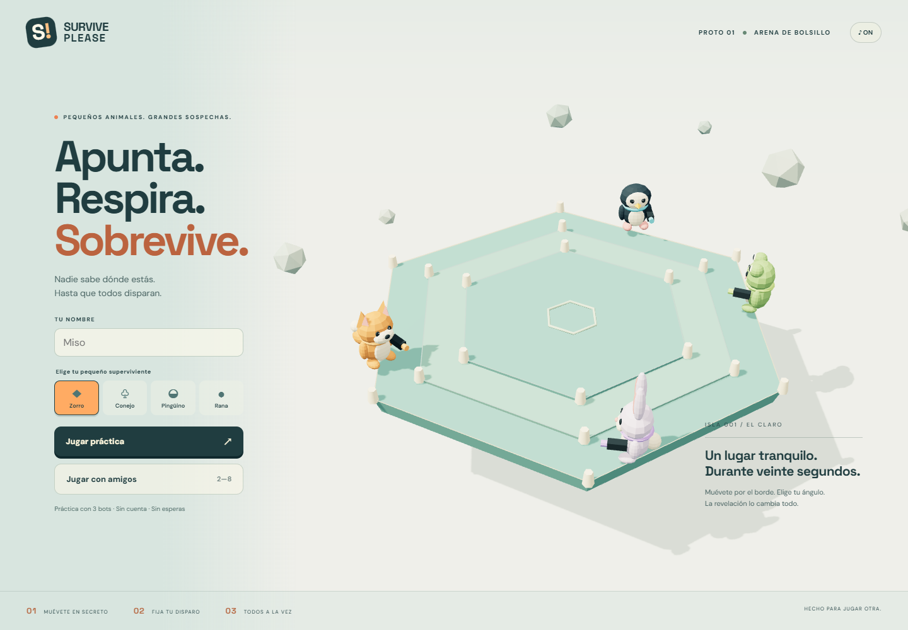

# SurvivePlease

**Muévete en secreto. Fija tu disparo. Todos a la vez.**

Interfaz del juego íntegramente en inglés. Ocho animales seleccionables: Fox, Rabbit, Penguin, Frog, Cat, Bear, Panda y Raccoon; modelos procedurales sin texturas ni descargas adicionales.

Prototipo web 3D de estrategia y predicción: animales de juguete en una arena hexagonal flotante. Modelos procedurales originales; sin assets de Roblox.



## Jugar

Node.js **22.12 o superior** y npm. Desde este directorio:

```sh
npm ci
npm run dev
```

Abre **http://localhost:5173** y pulsa **Play practice**. Tres bots permiten jugar una partida completa sin backend. Para multijugador, abre otra terminal:

```sh
npm run server
```

En dos navegadores o sesiones independientes, entra en **Play with friends**, crea una sala y comparte su código. La conexión a `ws://localhost:3001` es automática en desarrollo. Todos deben pulsar **Ready**; el anfitrión pulsa **Start match**. Al terminar, el anfitrión pulsa **Rematch**: todos vuelven al lobby de la misma sala con los mismos bots. Los humanos marcan **Ready** y el anfitrión inicia otra partida.

Desde otro dispositivo de la red, configura `VITE_WS_URL=ws://192.168.1.20:3001` antes de iniciar Vite y abre, por ejemplo, `http://192.168.1.20:5173`. Añade explícitamente el origen del frontend a `ALLOWED_ORIGINS` antes de iniciar el backend. No se han modificado reglas del firewall.

## Controles

| Acción | PC | Móvil / táctil |
| --- | --- | --- |
| Recorrer el perímetro | A / D, o flechas | Mantener ← / → |
| Apuntar | Ratón sobre la arena | Tocar o arrastrar sobre la arena |
| Fijar posición y disparo | Botón, espacio, Enter o clic en la arena | Botón **FIRE** |

Al fijar, quedas bloqueado hasta la siguiente ronda. El disparo sale con todos los demás. Si no confirmas, se registra el ángulo actual al vencer el tiempo: no pierdes por olvidar el botón.

## Reglas implementadas

- 2–8 participantes por sala, humanos y bots; hasta 5 salas por proceso. El anfitrión puede usar **Add bot / Remove bot** antes de iniciar, incluso jugar solo con bots online. Los bots quedan listos automáticamente y no mantienen salas vacías ni heredan el anfitrión. Práctica con tres bots que se mueven, apuntan, confirman, eliminan y mueren.
- Movimiento continuo por los seis bordes, incluyendo esquinas. Sin entrada al interior.
- Posicionamiento oculto de hasta 20 segundos. Termina antes si todos los vivos confirman.
- Revelación de personajes y nombres, pausa visual breve, disparos simultáneos, impactos, resultados y siguiente ronda. Los eliminados se ven caer únicamente en su propia resolución; después desaparecen y no vuelven a caer en revelaciones posteriores.
- Rayos contra el primer círculo válido de radio 0,48 m. Una sola instantánea para todos: también dispara quien muere en esa resolución. Hay eliminaciones mutuas y empate si no sobrevive nadie. Solo pueden recibir el impacto rivales cuya esquina más cercana sea distinta de la del tirador. Cada esquina abarca las dos mitades de borde adyacentes; el límite entre zonas es el punto medio del borde. Los personajes de la misma zona no bloquean el rayo. Tampoco hay impactos de contacto si el origen está dentro del área del rival, aunque estén a ambos lados de un límite. Esta regla se aplica también a bots y al núcleo final.
- 3 anillos para 2–4 participantes, 5 para 5–6, 7 para 7–8. Contracción cada tres rondas, manteniendo la coordenada proporcional del perímetro y su ángulo. Advertencia previa y transición animada.
- Cada contracción resta 3 segundos; mínimo 7 segundos. Tras alcanzar un anillo y quedar dos supervivientes, la siguiente contracción periódica lleva al **núcleo final** (radio 1,05 m frente a los 3 m del último anillo normal). El núcleo mantiene rondas de 7 segundos y no vuelve a encogerse; se reduce la velocidad lineal para conservar el control angular.
- Anti-AFK: máxima excursión real desde el punto inicial de la ronda, sobre el perímetro. Menos de 0,7 m incrementa el contador; dos rondas avisan, tres eliminan. Pulsaciones o vibraciones de milímetros no cuentan. Movimiento suficiente reinicia el contador.
- Zorro, conejo, pingüino y rana, con animaciones sencillas, sombras, nombres y sonido sintetizado de revelación.
- Menú, selección de personaje, lobby, HUD adaptable y resultados.

## Autoridad y privacidad

El cliente envía intención de movimiento (`-1`, `0`, `1`), ángulo y confirmación. El servidor calcula posición, reloj, bloqueo, colisiones, inactividad, contracción y ganador. No acepta coordenadas ni impactos declarados por clientes. La práctica comparte este motor de reglas. Los bots eligen ángulos hacia el centro con variación aleatoria sin consultar posiciones rivales ocultas.

Las teclas mantenidas no reenvían su repetición automática: el envío periódico de intención ya mantiene el movimiento, evitando superar los 40 mensajes/s y provocar el cierre `1008`. El servidor transmite instantáneas a 20 Hz sin duplicar respuestas a cada entrada. `src/online-motion.js` predice visualmente al jugador local entre paquetes y reconcilia suavemente sobre el perímetro; al bloquear/disparar se conserva la posición autoritativa. Nunca inventa posiciones de rivales ocultos. La extrapolación del reloj está acotada a 120 ms. En la revelación, las líneas crecen desde el arma durante 180 ms; la caída, el destello y el sonido de eliminación esperan a la llegada visual. Las colisiones siguen resolviéndose simultáneamente en el servidor.

Regresión: `node qa/online.mjs` verifica dos clientes, llenar/quitar bots, una tecla repetida a 40 eventos/s durante cuatro segundos sin desconexión, posiciones ocultas y siete disparos simultáneos. Simula 70 ms de envío y 60–80 ms de recepción; comprueba que el avatar cambia entre instantáneas en el preview local. Admite `QA_URL` para comprobar el despliegue público. Estas pruebas no sustituyen mediciones en dispositivos físicos o redes móviles reales.

Durante posicionamiento, cada paquete personalizado omite `s` y `aim` de todos los demás jugadores, incluso para espectadores eliminados. Identidad del lobby y confirmaciones son públicas. Durante revelación, todos reciben posiciones congeladas y los mismos rayos. Servidor a 20 Hz; el render interpola sobre el perímetro sin cortar esquinas por el interior.

Protecciones básicas: origen permitido, máximo 2 KiB por mensaje, 40 mensajes/s por conexión, 12 conexiones simultáneas y 20 aperturas/minuto por IP, cinco creaciones/minuto por IP y 10 segundos entre creaciones por conexión, ping/pong y limpieza de salas vacías. Una desconexión elimina al participante activo y transfiere el anfitrión. No hay cuentas, persistencia, reconexión ni protección DDoS de infraestructura.

## Organización y herramientas

```text
shared/game.js       Configuración, geometría, reglas, bots y vistas privadas
server/rooms.js      Salas, participantes, listo/inicio y desconexión
server/index.js      HTTP de salud, WebSocket y límites
src/animals.js       Modelos 3D originales por piezas geométricas
src/scene.js         Arena, cámara, sombras, animación y rayos
src/main.js          Pantallas, entradas, audio y transporte local/online
src/style.css        Identidad visual y adaptación táctil
test/game.test.js    Casos críticos de reglas y salas
qa/                 Pruebas de navegador, resultados y capturas
```

Balance centralizado en `CONFIG`, en `shared/game.js`. Three.js permite crear/renderizar los recursos 3D sin exportador; Vite construye el frontend; `ws` aporta WebSocket sin framework de servidor. JavaScript ESM comparte directamente reglas entre navegador, Node y pruebas. Las fuentes web son opcionales, con fallback de sistema.

## Verificación

```sh
npm test
npm run build
# Con frontend/backend arrancados y Microsoft Edge instalado:
node qa/browser.mjs
node qa/multiplayer.mjs
node qa/fixes.mjs
node qa/profile.mjs after
```

25 pruebas: muertes visibles una sola vez, núcleo final y límites, confirmación anticipada, timeout, eliminaciones simultáneas, primer impacto, zonas de esquina, protección de superpuestos y límites entre zonas, movimiento, contracción, mínimo, AFK, privacidad, validación y límites de salas. La prueba de navegador juega una práctica completa hasta el resultado y captura escritorio (1440×1000) y móvil emulado (390×844). La prueba online usa dos contextos de Edge independientes y conexiones WebSocket reales: lobby, movimiento, resolución anticipada, paquetes privados, rayos idénticos, desconexión y rechazo de origen no autorizado.

Resultados: [navegador](qa/browser-results.json), [multijugador](qa/multiplayer-results.json). Capturas: [fase oculta](qa/desktop-hidden.png), [revelación](qa/desktop-reveal.png), [resultado](qa/desktop-results.png), [móvil](qa/mobile-hidden.png), [lobby online](qa/multiplayer-lobby.png).

**Límites:** Edge headless en Windows y emulación táctil; sin pruebas en móvil físico, Safari/Firefox, rendimiento térmico, cinco salas/40 jugadores simultáneos ni red pública. Vite avisa de un bundle ligeramente mayor de 500 kB sin comprimir (aprox. 136 kB gzip), incluido Three.js.

## Revisión móvil

Se conservan tres botones inferiores: **←**, **→** y **FIRE**, con el mismo diseño. El apuntado sigue siendo táctil sobre la arena. Los botones miden al menos 57×60 píxeles CSS; probados en vertical (390×844) y horizontal (844×390). Una segunda pulsación para apuntar no interrumpe el dedo que mantiene el movimiento. Advertencias y ayudas quedan fuera de la fila de controles.

Perfil móvil automático para puntero táctil o pantalla estrecha: DPR máximo 1,25 (escritorio 1,75), sombras suaves de 1024² (escritorio 2048²), render limitado a 60 cuadros/s y HUD actualizado a 10 Hz. Se agrupan piezas estáticas por material e instancian los postes de cada anillo. La guía de apuntado reutiliza sus buffers en vez de destruir y crear geometría cada cuadro.

Medición reproducible en [antes](qa/performance-before.json) y [después](qa/performance-after.json), ocho animales y siete anillos, misma escena de revelación sin rayos:

| Render móvil emulado DPR 3 | Antes | Después |
| --- | --- | --- |
| Llamadas de dibujo del render principal (`renderer.info`) | 238 | 77 |
| Triángulos | 25 958 | 25 958 |
| Resolución del canvas | 682×1477 | 487×1055 |
| JS de producción gzip | 132,9 kB | 135,5 kB |

Se reduce un 68 % el número de llamadas de dibujo y un 49 % los píxeles del canvas, manteniendo la geometría y la dirección visual. El tamaño de JS sube unos 2,6 kB gzip por la agrupación de geometrías y las correcciones; no hay texturas ni modelos 3D que descargar. CSS añade unos 4 kB gzip y las fuentes web son opcionales. Estas cifras son del render principal y **no incluyen un desglose GPU de las pasadas de sombra**. Los tiempos de cuadros del host emulado no prueban FPS, batería ni temperatura en teléfonos físicos.

Pruebas específicas y capturas: [resultado](qa/fixes-results.json), [controles](qa/mobile-controls-v2.png), [horizontal](qa/mobile-landscape-v2.png), [núcleo](qa/final-duel-desktop.png). Se han comprobado con eventos táctiles emulados múltiples, sin errores de JavaScript.

## Tema final: bosque y arena oscura

Fondo petróleo `#172b31`, arena azul pizarra `#111d2d` / `#192a3d` y guía de disparo clara sin cambios. Texto crema sobre el fondo oscuro; paneles claros conservan texto oscuro. Los pinos y rocas usan cuatro lotes instanciados, sin texturas ni sombras adicionales: nueve pinos en escritorio y seis en móvil, menos en el menú para despejar el formulario. La decoración se adapta al encuadre y queda fuera del perímetro jugable, también en el núcleo.

Perfil reproducible: `node qa/profile.mjs forest`, [resultado](qa/performance-forest.json). En la escena móvil emulada de ocho personajes y siete anillos, el render principal registra 70 llamadas frente a las 77 de la versión anterior, y 26 122 triángulos frente a 25 958. El JS de producción ronda 136 kB gzip. No son mediciones de FPS, batería o temperatura en un teléfono físico. Capturas y comprobación: [resultado](qa/forest-results.json), [menú](qa/forest-desktop-menu.png), [partida](qa/forest-desktop-play.png), [móvil](qa/forest-mobile-play.png).

## Desplegar frontend

```sh
npm ci
npm run build
```

Publica **`dist/`** en un alojamiento estático HTTPS. Las rutas relativas de `vite.config.js` permiten subdirectorios como GitHub Pages. El workflow manual **Deploy frontend to Pages** construye y publica la práctica: actívalo desde Actions después de fusionar, con Pages configurado como **GitHub Actions**. No publica al abrir el PR.

Establece `VITE_WS_URL=wss://tu-backend.example` antes de construir, o introduce la URL en el menú. HTTPS requiere `wss://`. **GitHub Pages no ejecuta WebSocket.**

## Desplegar backend

Servicio Node persistente o contenedor con soporte WebSocket. Incluye `package.json`, `package-lock.json`, `server/` y `shared/`; instala `npm ci --omit=dev` y ejecuta `npm run server`.

| Variable | Valor |
| --- | --- |
| `PORT` | Puerto HTTP/WebSocket, predeterminado `3001` |
| `ALLOWED_ORIGINS` | Orígenes exactos separados por comas, sin `/` final; por ejemplo `https://wzzzodiac.github.io` |

PowerShell:

```powershell
$env:PORT='3001'
$env:ALLOWED_ORIGINS='https://wzzzodiac.github.io'
npm run server
```

Docker (compilado y desplegado con Cloud Build en esta entrega):

```sh
docker build -t surviveplease-server .
docker run --rm -p 3001:3001 -e ALLOWED_ORIGINS=https://wzzzodiac.github.io surviveplease-server
```

Configura TLS y upgrade WebSocket en el proxy. **`GET /health`** devuelve salud y cantidad de salas. Usa una instancia: las salas viven en memoria y se pierden al reiniciar. Varias réplicas necesitarían afinidad/coordinación. Los límites usan la IP del socket: detrás de un proxy se comparten entre los clientes que llegan desde la misma IP del proxy. No se confía automáticamente en `X-Forwarded-For`; configura el proxy antes de abrir un servicio a gran escala.

## Cloud Run en producción

Proyecto **Walter Projects** (`orbital-artillery`), servicio **surviveplease**, región **europe-west1**. Backend: `https://surviveplease-873648916633.europe-west1.run.app`; WebSocket: `wss://surviveplease-873648916633.europe-west1.run.app`. `/health` responde `200` y `{"ok":true,"rooms":0}` sin salas activas.

Configuración: 1 CPU, 512 MiB, facturación por solicitudes, mínimo 0 y máximo 1 instancia, concurrencia 80 y timeout WebSocket de 3600 segundos. Origen permitido: `https://wzzzodiac.github.io`. Cloud Build compila el Dockerfile y despliega los cambios de `main` automáticamente. Las salas viven en memoria y se pierden al reiniciar o desplegar; no hay reconexión automática.

El frontend Pages usa la variable de repositorio `VITE_WS_URL`. La conexión es automática: el formulario solo pide el código de sala y no usa direcciones antiguas guardadas en el navegador. Cada actualización del frontend requiere ejecutar el workflow de Pages.

En Cloud Run (`K_SERVICE`), se permiten hasta 40 conexiones por instancia y 80 aperturas/minuto por IP del proxy; se conservan 40 mensajes/s por conexión, cinco creaciones/minuto por IP y el máximo de cinco salas. No se confía en `X-Forwarded-For`. En local siguen los límites de 12 conexiones y 20 aperturas/minuto por IP. La prueba local de compatibilidad admite 40 conexiones con una misma IP y rechaza la 41 ([resultado](qa/cloud-run-capacity.json)); no es una prueba de carga de Cloud Run.

Verificación pública con dos contextos de Edge y WebSocket reales: crear/unirse, listo/inicio, movimiento, privacidad de paquetes, disparos idénticos, desconexión y rechazo de un origen no autorizado ([resultado](qa/multiplayer-results.json)). Repetir con `QA_URL` y `QA_WS_URL` al ejecutar `node qa/multiplayer.mjs`.

## Audio

Música de bosque en bucle y efectos originales de disparos/eliminaciones, sincronizados con la revelación. Se activan con el primer gesto, se pausan al ocultar la pestaña y se silencian con `♪ ON / OFF` también dentro de la partida. La flecha contigua despliega el volumen maestro para música y todos los efectos; volumen y silencio se guardan por separado en el navegador. El MP3 pesa 1.17 MB y se carga al activar audio; no se decodifica completo en un buffer de JavaScript. Fuente, licencia y adaptación: [AUDIO_CREDITS.md](AUDIO_CREDITS.md).

Verificación: `npm test`, `npm run build` y `node qa/audio.mjs` (Edge, escritorio y viewport táctil de 320 px; no dispositivo físico). La prueba comprueba gesto inicial, reproducción, silencio persistente, pausa/reanudación y síntesis de efectos sin clipping.

## Estado

Práctica y multijugador publicados y comprobados con dos clientes en la red pública. Quedan pruebas de carga/dispositivos físicos, reconexión automática.
